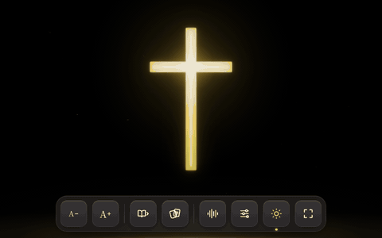

## Light of the World｜世界的光

  

自製 worship 背景頁面網頁

### 線上網址

👉 **https://rainless1125.github.io/worship_web/**

手機或電腦用瀏覽器直接打開即可；手機可「加入主畫面」當作 App 使用。

### 使用方式

直接用瀏覽器打開 `worship.html` 即可，不需要安裝任何東西（打開 `index.html` 也會自動跳轉過去）。

### 功能

- 發光十字架（呼吸光），下方輪播 100 則和合本經文（新標點和合本・神版，已逐字核對）（可依序或隨機）
- 畫面特效：天降光束、光點粒子、銀河星空、弧線流星、地平線微光（皆可在設定選單開關）
- 按「下一則經文」時，星空曲速推進、光束光波與粒子漣漪同步觸發
- 底部 Dock 功能列：字體放大／縮小、下一則、隨機播放、設定、防止螢幕休眠、全螢幕
- 8 種經文字體可切換，設定會記在瀏覽器中
- 音樂律動：按 Dock 上的聲波鍵分享電腦音訊（Windows Chrome／Edge 選整個螢幕並勾選「分享系統音訊」，或選播放音樂的分頁），可開關底部頻譜（流光波形／升起的光粒兩種樣式）與特效隨音樂律動

### 檔案

- `worship.html`：敬拜頁面本體
- `index.html`：自動跳轉到 `worship.html`
- `icons/`：網站圖示（`logo.svg` 為原始向量檔）
- `docs/preview.gif`：README 開頭的預覽動畫

### 備註

- 光束、粒子、星空使用 WebGL2，建議使用近幾年版本的 Chrome、Edge、Safari 或 Firefox
- 字體由 Google Fonts 載入，離線時會改用系統字體
- 頁面特效與UI元素部分引用自 https://www.reactbits.dev/

